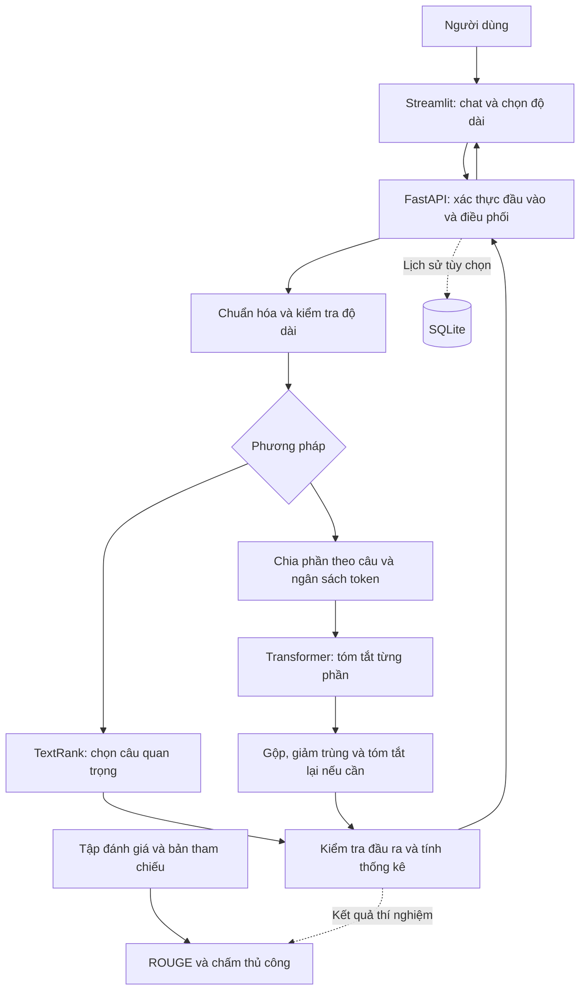

# Phase 1 — Checklist xác định yêu cầu và thiết kế hệ thống

Trạng thái: chưa bắt đầu triển khai. Thời gian dự kiến: 2–3 ngày. Phụ thuộc: không.

## Mục tiêu

Chuyển mô tả đồ án thành phạm vi thực hiện, kiến trúc và tiêu chí nghiệm thu rõ ràng trước khi viết mã.

## 1. Xác định bài toán

- [ ] Chốt tên đề tài: **Xây dựng chatbot tóm tắt văn bản tiếng Việt bằng TextRank và Transformer**.
- [ ] Mô tả đầu vào: văn bản tiếng Việt có nhiều câu/đoạn; ưu tiên tin tức và bài viết thông tin trong bản đầu.
- [ ] Mô tả đầu ra: bản tóm tắt ngắn hơn nguồn, giữ ý chính, dễ đọc; kiểm tra và đo lỗi sai lệch thông tin.
- [ ] Phân biệt giao diện chatbot tóm tắt với trợ lý hội thoại tổng quát; trong phạm vi chính, mỗi yêu cầu tóm tắt gắn với một văn bản nguồn.
- [ ] Ghi nhận các yếu tố chưa biết: hạn nộp, số thành viên, CPU/RAM/GPU/VRAM, miền dữ liệu và yêu cầu của giảng viên.
- [ ] Dùng giả định làm việc ban đầu: một người thực hiện, demo cục bộ, tiếng Việt, suy luận bằng mô hình có sẵn; cập nhật khi có thông tin thực tế.

## 2. Chốt phạm vi chức năng

### Bắt buộc

- [ ] Nhập văn bản bằng khung chat hoặc vùng dán văn bản và nút gửi.
- [ ] Kiểm tra rỗng, chuẩn hóa khoảng trắng và Unicode, kiểm tra độ dài bằng tokenizer của mô hình.
- [ ] Thông báo văn bản vượt ngưỡng một lần suy luận; dùng chia phần khi nằm trong giới hạn toàn hệ thống hoặc từ chối rõ lý do khi vượt giới hạn đó.
- [ ] Cung cấp TextRank và Transformer để chạy thử, so sánh trong thực nghiệm.
- [ ] Cung cấp ba mức Ngắn/Vừa/Chi tiết với mục tiêu độ dài có cấu hình.
- [ ] Hiển thị văn bản gốc, bản tóm tắt, thống kê độ dài, tỷ lệ rút gọn, thời gian xử lý.
- [ ] Xử lý lỗi đầu vào, lỗi tải mô hình, thiếu tài nguyên và đầu ra không hợp lệ bằng thông báo dễ hiểu.
- [ ] Đánh giá ROUGE-1/2/L và đánh giá con người.

### Tùy chọn, chọn sau khi có bản chạy cơ bản

- [ ] Tải TXT, DOCX, PDF có lớp văn bản; OCR cho PDF ảnh là hạng mục riêng.
- [ ] Lưu và xem lại lịch sử bằng SQLite.
- [ ] Hiển thị TextRank và Transformer cạnh nhau trên giao diện.
- [ ] Xuất tóm tắt về tệp.
- [ ] Hỏi đáp dựa trên tài liệu, trả lời kèm đoạn bằng chứng.
- [ ] Hỗ trợ ngôn ngữ khác bằng mô hình được kiểm chứng riêng.
- [ ] Tinh chỉnh thêm mô hình; thử chế độ kết hợp trích xuất và trừu tượng.

## 3. Chọn công nghệ và mô hình

- [ ] Chọn Python; xác minh phiên bản tương thích với PyTorch, Transformers và thư viện NLP trong phase 2.
- [ ] Chọn underthesea cho tách câu/tách từ tiếng Việt; chỉ bổ sung NLTK khi có nhu cầu phù hợp.
- [ ] Chọn scikit-learn và NetworkX cho biểu diễn TF-IDF, đồ thị và PageRank của TextRank.
- [ ] Chọn Hugging Face Transformers + PyTorch cho tóm tắt trừu tượng; Pandas cho xử lý dữ liệu và kết quả thực nghiệm.
- [ ] Thử checkpoint `VietAI/vit5-base-vietnews-summarization`, rồi chốt sau kiểm tra chất lượng và tài nguyên. Đây là mô hình đã tinh chỉnh cho tóm tắt, khác với checkpoint chỉ được tiền huấn luyện.
- [ ] Dùng `AutoTokenizer`, `AutoModelForSeq2SeqLM` và `generate()`; kiểm tra API theo phiên bản được khóa.
- [ ] Chọn Streamlit cho giao diện, FastAPI cho API, SQLite cho lịch sử tùy chọn và Git/GitHub cho quản lý mã nguồn.
- [ ] Ghi model ID, revision, giấy phép, phiên bản tokenizer và cấu hình sinh vào quyết định kỹ thuật.

Nguồn: [model card của VietAI](https://huggingface.co/VietAI/vit5-base-vietnews-summarization), [hướng dẫn Transformers](https://huggingface.co/docs/transformers/main/tasks/summarization).

## 4. Thiết kế kiến trúc

- [ ] Thống nhất sơ đồ thành phần sau và trách nhiệm của mỗi khối.

- [ ] Giao diện chỉ gọi API; thuật toán và mô hình nằm trong backend, được tái sử dụng bởi chương trình đánh giá.
- [ ] Backend tải mô hình một lần cho tiến trình phục vụ; tránh nhân bản model khi cấu hình nhiều worker.
- [ ] Tách tiền xử lý, chiến lược tóm tắt, thống kê, lưu trữ và đánh giá thành module riêng.
- [ ] Ghi nhận ảnh 1 là tham khảo luồng frontend–backend; bản đề xuất dùng mô hình Hugging Face chạy tại máy, không phụ thuộc OpenAI API hoặc Hamilton.
- [ ] Ghi nhận ảnh 2 là tham khảo vòng đời dữ liệu–mô hình–đánh giá; fine-tuning là bước offline tùy chọn, không chạy mỗi yêu cầu tóm tắt.
- [ ] Ghi nhận ảnh 3 là tham khảo kiến trúc xử lý tài liệu dài; không tự ghép Longformer vào ViT5. Muốn thử mô hình ngữ cảnh dài phải chọn checkpoint tương thích và đánh giá riêng.

## 5. Quy định xử lý văn bản và thống kê

- [ ] Giữ nguyên dấu tiếng Việt, dấu câu, tên riêng, số liệu và ranh giới đoạn có ý nghĩa; không xóa stopword trên văn bản đưa vào Transformer.
- [ ] Phân biệt ba đại lượng: đơn vị cách trắng để thống kê hiển thị, từ đã tách cho một số thuật toán/đánh giá, token subword để kiểm tra giới hạn mô hình.
- [ ] Hiển thị rõ nhãn “đơn vị cách trắng” nếu đếm bằng khoảng trắng; không gọi đó là số từ tiếng Việt chính xác.
- [ ] Thống nhất tính thống kê trên văn bản đã chuẩn hóa mà mô hình thực sự nhận; vẫn giữ bản gốc để hiển thị.
- [ ] Thống nhất công thức: `R = (N_gốc - N_tóm_tắt) / N_gốc × 100%`, dùng cùng đơn vị đếm, không chia khi `N_gốc = 0`.
- [ ] Định nghĩa thời gian xử lý backend và thời gian giao diện chờ; báo thời gian tải model ban đầu riêng trong thực nghiệm.
- [ ] Chốt `max_request_chars`, ngân sách token mỗi phần, số phần tối đa và số vòng gộp sau benchmark; không mặc định 512/1024 token cho mọi mô hình.
- [ ] Xử lý văn bản quá ngắn bằng thông báo hoặc giữ nguyên kèm trạng thái “không cần tóm tắt”; không tuyên bố đã rút gọn.

## 6. Lập kế hoạch dữ liệu và đánh giá

- [ ] Chọn nguồn dữ liệu có cặp `document`/`reference_summary`, kiểm tra giấy phép và nguồn gốc.
- [ ] Có tập mẫu thủ công để thử sớm và tập kiểm thử cố định để đánh giá cuối.
- [ ] Tách train/validation/test nếu tự tinh chỉnh; loại trùng và gần trùng giữa các phần.
- [ ] So sánh Lead baseline, TextRank và Transformer trên cùng tập và thiết lập độ dài được công bố.
- [ ] Quy định cách tách token tiếng Việt khi tính ROUGE, bảo toàn Unicode và không dùng English stemming.
- [ ] Thiết kế phiếu chấm 1–5: đầy đủ, chính xác, mạch lạc, súc tích; thống nhất điểm cao luôn tốt hơn.
- [ ] Đặt chỉ tiêu chất lượng sau pilot, trước khi chạy test cuối; không tự cam kết một ngưỡng ROUGE khi chưa có dữ liệu.

## 7. Sản phẩm và điều kiện hoàn thành

- [ ] Có tài liệu yêu cầu và danh sách phạm vi bắt buộc/tùy chọn.
- [ ] Có sơ đồ kiến trúc, luồng xử lý và danh sách module dự kiến.
- [ ] Có quyết định công nghệ, mô hình ứng viên và kế hoạch kiểm tra phần cứng.
- [ ] Có tiêu chí nghiệm thu cho bốn chức năng chính và kế hoạch đánh giá.
- [ ] Mọi quyết định chưa xác minh đều được ghi là giả định hoặc việc cần kiểm chứng.

Hoàn thành phase khi có đủ các sản phẩm trên; chuyển sang [phase 2](phase2.md).
